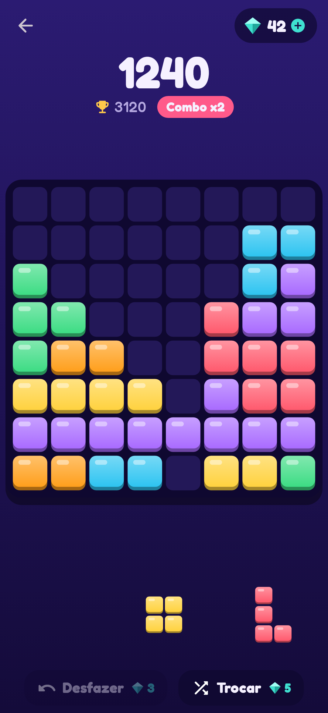
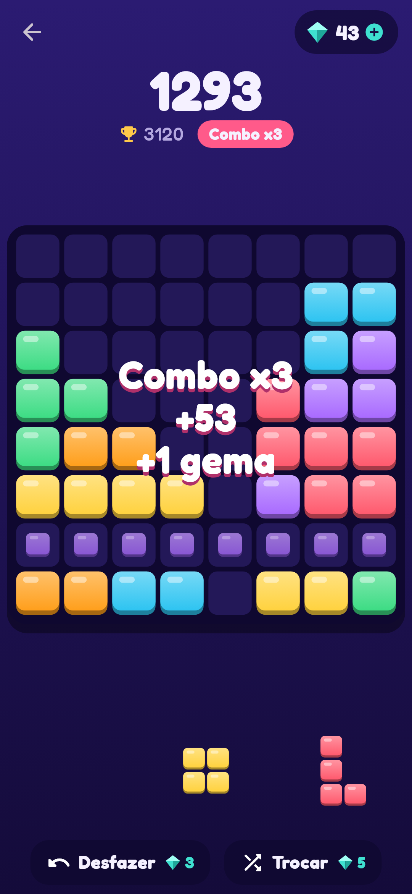
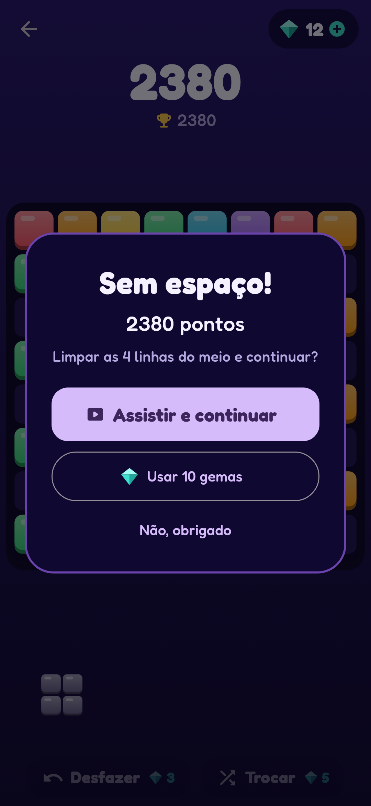

# Encaixa 🧩

Quebra-cabeça de blocos para Android: arraste as peças para a grade 8×8, complete linhas e colunas para limpá-las e
encadeie combos. Linha **de uma cor só** vale bônus e gema. Todo dia há um **Desafio do dia** com as mesmas peças para
todo mundo, e o resultado pode ser compartilhado.

| Início | Jogando | Combo | Segunda chance | Loja |
|---|---|---|---|---|
|  |  |  |  |  |

## Por que Flutter (Dart)

| Opção | A favor | Contra |
|---|---|---|
| **Flutter + Dart** ✅ | Já usado nos outros projetos (Loja Max, Salão Max); plugins oficiais do Google para **AdMob** e **compras/assinatura**; testes rápidos sem emulador; gera imagens das telas nos testes | Não é motor 3D/física |
| Unity (C#) | Motor de jogos mais usado no celular, editor visual | APK pesado, licença/taxas, não roda testes/capturas no CI tão fácil; exagero para um puzzle 2D |
| Godot (GDScript) | Leve e livre | Anúncios e compras dependem de plugins da comunidade |

Para um puzzle 2D com anúncios, itens e assinatura, Flutter entrega tudo com menos peças. Se um dia o jogo precisar de
física ou 3D, a regra do jogo (`app/lib/jogo/`) é Dart puro e fácil de portar.

## Estrutura

```
app/                      projeto Flutter (só Android)
  lib/jogo/               regras: tabuleiro, peças, pontuação, sorteio determinístico — sem Flutter
  lib/servicos/           progresso (no aparelho), anúncios (AdMob), compras (Google Play)
  lib/telas/              início, jogo e loja
  lib/widgets/            tabuleiro e peças desenhados com CustomPainter
  lib/tema.dart           cores e o desenho dos blocos (toda a arte é vetorial)
  test/                   regras, política de anúncios, telas (e capturas), artes da loja
docs/                     design do jogo, monetização, publicação, telas e artes
```

## Rodar

```bash
cd app
flutter pub get
flutter run                 # aparelho/emulador Android
flutter analyze && flutter test
```

Telas e artes: veja [docs/TELAS.md](docs/TELAS.md). Publicação: [docs/PUBLICAR.md](docs/PUBLICAR.md).

## Documentos

- [Design do jogo](docs/JOGO.md) — regras, pontuação, o que o torna viciante
- [Monetização](docs/MONETIZACAO.md) — anúncios, gemas, "Sem anúncios", assinatura Encaixa+
- [Publicar](docs/PUBLICAR.md) — Play Console, AdMob, segredos do GitHub, CI
- [Telas e artes](docs/TELAS.md)
